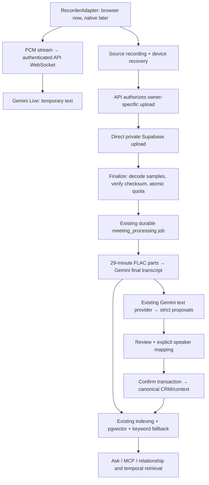

# Meeting Intelligence V1 handoff — 2026-10-08

**Status: local implementation complete; hosted acceptance BLOCKED.** The user's
definition of DONE includes recording Bangla + English on a physical phone,
processing through real Gemini/private Supabase, confirming CRM changes and asking
a cited question. That test has not run. Local tests do not establish that result.

## Branch, SHA and files

- Branch: `feature/meeting-intelligence-v1`.
- Current HEAD/base: `8862f701c8a2ef12aff58bdf7613da8eb40e87ec`.
- Implementation is **uncommitted**. There is no final implementation commit SHA.
  No commit, push, main merge, production migration or deployment was performed.
- Exact intended files and content hashes: [FILES_CHANGED.md](FILES_CHANGED.md).
  Existing unrelated untracked recovery files, render.yaml, archives and .agents
  were preserved and are excluded from that manifest.
- New migration: [20261008000032_meeting_intelligence.sql](../../supabase/migrations/20261008000032_meeting_intelligence.sql).
- Initial audit: [IMPLEMENTATION_AUDIT.md](IMPLEMENTATION_AUDIT.md).

## Product behavior

Meetings now supports recording or uploading, a monthly allowance, private uploads,
live text, recoverable local recordings, background processing, summary-first
review, explicit speaker naming and Save all/Save selected. Live failures leave the
source recording running. AI suggestions create no promises, tasks or relationship
changes until confirmation. Repeated confirmation returns the same receipt.

After confirmation, existing Meetings, Interactions, Commitments, Tasks, Decisions,
Memories, ContextEvents and EntityEdges carry the result. Meeting/person timeline
links use source evidence and confirmed speaker mappings. Unknown voices remain
unknown. Existing Ask, MCP, weekly-review and relationship retrieval paths consume
the existing index and canonical records; no separate meeting search was added.

## Developer architecture



The capture layer separates RecorderAdapter, AudioUploadClient,
LiveTranscriptClient, MeetingApiClient and MeetingProcessingStatus. Browser-only
MediaRecorder/AudioContext code stays inside adapters. Native apps can use the
same FastAPI REST/WebSocket contract, independent of Next.js.

Google supports ephemeral Live tokens. V1 deliberately uses the officially
supported authenticated backend relay so the server can meter every transmitted
PCM frame and enforce the product allowance. A direct client token alone would
not provide that enforcement. The permanent key stays in a server-only header.

The UTC calendar month counter is atomic per owner/metric/period. Live reserves
crossed seconds before provider transmission; final upload charges only the
additional difference between the decoded duration and already charged live time.
Pauses consume no streamed audio. Abandoned live use remains charged. A capture
that starts consuming audio before a month boundary stays charged to that month;
a never-charged old draft uses the month of its first charge. Nothing rolls over.

Source duration comes from decoded 16 kHz mono samples, not client duration or an
editable container header. Decoding is streamed and bounded. Audio-only files are
required. Source checksum prevents replacement after finalization. Hosted uploads
go straight to Storage; Next.js/Vercel never carries the audio bytes. Development
disk upload is owner-authenticated and disabled for staging/production.

Final transcription parts are nonoverlapping and 29 minutes long. Word offsets
become absolute. `c0:spk_1` and `c1:spk_1` remain separate labels until a user maps
them. Live sessions rotate around 500 seconds, before the 10-minute provider limit.
Live offsets preserve gaps during reconnect/backpressure; live text remains
temporary and never replaces the final transcript.

Extraction uses bounded transcript windows and the existing private text scope.
Every candidate needs exact transcript evidence. Deadlines need a matching
explicit date **and year**; supported forms include ISO dates and named English/
Bangla month dates. Relative/ambiguous deadlines are rejected. Interpretations
stay marked. User-selected facts/feedback remain with the Meeting rather than
overwriting Person facts or creating organizations/projects automatically.

Processing states: draft → recording/uploading → uploaded → transcribing →
extracting → awaiting_review → completed; failures enter failed. Finished
transcription chunks survive worker restart; extraction retry reuses the saved
transcript. The existing worker polls/reclaims jobs and retries with backoff.
Transcription and extraction failures have separate safe error codes; private
content and provider exception bodies are never logged.
An outer worker timeout also moves the capture into a retryable failed state,
preserving completed transcription rather than leaving it stuck extracting.

Raw source retention starts when the canonical transcript has been persisted,
including when the subsequent extraction fails. After 7 days, playback is denied
and durable storage deletion is queued. Transcript/extraction remain. A failed
transcription retains the source for retry/user deletion. Account closure erases
both buckets and meeting-derived database data. Device copies clear on successful
upload, explicit discard, or deletion requested on that device; copies on another
device require clearing that device's site data. Browser storage cannot guarantee
survival if the OS evicts it or the user closes the page before its latest chunk.

## Official API verification

Verified current official docs on 2026-10-08. Defaults remain
`gemini-3.5-transcribe` and `gemini-3.5-transcribe-live`; text and embedding model
settings remain independent. Final transcription uses the Files + Interactions
REST contract with `store=false`, verbatim mode, automatic language detection,
speaker labels and word annotations. Provider upload files are deleted in finally.
[Google transcription docs](https://ai.google.dev/gemini-api/docs/transcribe).

Live sends raw 16-bit mono little-endian PCM at 16 kHz with
`audio/pcm;rate=16000` over the official Live WebSocket. Google documents a
10-minute session limit and no live speaker labels.
[Google Live transcription docs](https://ai.google.dev/gemini-api/docs/live-api/live-transcribe).

Both dedicated transcription models have a free tier, whose data may be used to
improve Google's products. `AI_DATA_MODE=free_redacted` **does not redact audio**.
The user sees and accepts that before recording/uploading. Mode changes invalidate
old capture consent rather than silently sending audio under changed terms.
Changing this flag alone does not change Google's project billing/privacy tier.
[Google pricing/data-use table](https://ai.google.dev/gemini-api/docs/pricing).

The source limit is 52,428,800 bytes (50 MiB, labeled 50 MB in the UI), matching
Supabase's Free plan limit. The global Storage setting must also permit that size.
Supabase recommends resumable uploads for larger files; V1 keeps direct signed
standard upload plus local recovery/retry, with resumable uploads planned next.
[Supabase limits](https://supabase.com/docs/guides/storage/uploads/file-limits),
[standard uploads](https://supabase.com/docs/guides/storage/uploads/standard-uploads).

## Environment configuration

Use a **separate nonproduction** Supabase project and Render/Vercel staging
services. Copy placeholders from `apps/api/.env.example`; never paste secrets into
chat, Git, or NEXT_PUBLIC variables.

| Backend variable | Required value / meaning |
| --- | --- |
| APP_ENV, ENVIRONMENT | `staging` for hosted dogfood |
| DATABASE_URL | Staging PostgreSQL asyncpg URI; actual DB login must be `postgres` |
| DATABASE_SCHEMA_VERIFY | `true` |
| SUPABASE_URL | Staging project URL |
| SUPABASE_SECRET_KEY | Staging server secret; legacy SERVICE_ROLE key is an existing fallback |
| JWT_SECRET, TOKEN_ENCRYPTION_KEY | Preserve distinct existing strong server secrets |
| GEMINI_API_KEY | Google AI Studio key for an unpaid project |
| GEMINI_TRANSCRIBE_MODEL | `gemini-3.5-transcribe` |
| GEMINI_LIVE_TRANSCRIBE_MODEL | `gemini-3.5-transcribe-live` |
| GEMINI_MODEL, GEMINI_EMBEDDING_MODEL | Preserve existing independent values; validate access in smoke testing |
| AI_DATA_MODE | `free_redacted` |
| AI_MAX_INPUT_CHARS | `24000` (existing limit) |
| MEETING_AUDIO_MONTHLY_LIMIT_SECONDS | `18000` |
| MEETING_AUDIO_RETENTION_DAYS | `7` |
| MEETING_AUDIO_MAX_BYTES | `52428800` (V1 maximum) |
| MEETING_AUDIO_BUCKET | `meeting-audio`; migration installs this bucket/policies |
| MEETING_LIVE_SESSION_SECONDS | `540` |
| MEETING_FFMPEG, MEETING_FFPROBE | `ffmpeg`, `ffprobe`; included by Dockerfile |
| JOB_WORKER_ENABLED | `true` |
| FRONTEND_URL | Exact staging web origin, no trailing slash |
| CORS_ORIGINS, CORS_ALLOWED_ORIGINS | JSON arrays containing the exact staging web origin |

Web requires `NEXT_PUBLIC_SUPABASE_URL`,
`NEXT_PUBLIC_SUPABASE_PUBLISHABLE_KEY` (or existing ANON_KEY), and
`NEXT_PUBLIC_API_BASE_URL=https://<staging-api-host>/api/v1`. Keep Gemini and
Supabase server credentials out of the browser. The bucket name should remain
`meeting-audio` unless a separate reviewed migration changes its policies too.

## Exact staging setup

These are instructions to perform after code review and explicit publication
authorization; they were not executed here. First commit/publish only the manifest
files to the feature branch so the staging services can fetch them. Do not merge main.

**Google AI Studio**

1. Open [AI Studio API Keys](https://aistudio.google.com/api-keys). In Dashboard →
   Projects, import/select a separate testing project if it is not listed.
2. On API Keys, click **Create API key** and select that project. Newly created
   keys use Google's current authorization-key flow. Keep the project on Free
   tier; do not click billing upgrade or link billing for this V1.
3. Copy the key privately into Render's `GEMINI_API_KEY` field. Do not add it to
   Vercel public variables. Run the optional provider smoke below before dogfood.
   A key's mere existence does not prove either model is accessible in your region.
   [Official key setup](https://ai.google.dev/gemini-api/docs/api-key).

**Supabase — separate staging project**

1. Open the staging project; confirm its project ref differs from production.
   Project Settings → API Keys provides publishable and server secret keys.
   Use the public key only on web; use the secret only on FastAPI.
2. Click **Connect** → connection string. Use the direct connection, or session
   pooler if IPv4 is required, as the postgres login. Adapt its scheme to
   `postgresql+asyncpg://` for DATABASE_URL. Do not use transaction pooling for the
   application's current RLS session assumptions without a separate review.
3. On a migrated V1.5 staging project, inspect `supabase_migrations.schema_migrations`
   and the existing schema first. In **SQL Editor → New query**, paste **only**
   `supabase/migrations/20261008000032_meeting_intelligence.sql` and click Run.
   Record migration version `20261008000032` in your established migration ledger
   workflow; raw SQL Editor execution does not automatically record CLI history.
   On a fresh project, apply the entire existing migration history in order via
   your existing migration workflow before deploying this API. Never replay the
   bootstrap script against an already populated project.
4. **Storage → Settings → Global file size limit**: `50 MB`.
   **Storage → meeting-audio → bucket settings**: Public **off**, size limit
   `50 MB`. The migration supplies the allowed audio MIME list and owner policies.
   Do not replace the restrictive policies with a broad authenticated rule.
5. **Authentication → URL Configuration**: Site URL = staging web origin; add
   `https://<staging-web-host>/**` to Redirect URLs. Create/sign in two normal test
   users through the app. Keep service-role credentials out of the user-boundary
   acceptance test.

**Render — staging API**

1. Dashboard → **New → Web Service** → connect `t4j44/mysecondbrain` and select
   branch `feature/meeting-intelligence-v1`. Use a separate service name such as
   `second-brain-meetings-staging`; never edit the production service.
2. Set **Language = Docker**, leave **Root Directory blank**,
   **Dockerfile Path = apps/api/Dockerfile**, **Docker Build Context Directory = apps/api**.
   Leave Docker Command blank so the existing Docker CMD uses Render's PORT.
   This includes both FFmpeg binaries; a native Python runtime does not.
   [Render Docker settings](https://render.com/docs/docker).
3. In **Environment**, enter backend values from the table. Set Health Check Path
   in **Settings** to `/health/ready`; disable automatic deployment while reviewing.
4. For unattended processing after leaving the page, use an always-running API or
   worker runtime. Render Free web services sleep after 15 minutes without inbound
   HTTP/WebSocket traffic. Jobs persist but can wait until the service wakes; free
   hosting cannot guarantee the uninterrupted background acceptance requirement.
   This is a hosting decision, not a paid AI dependency.
   [Render Free behavior](https://render.com/docs/free).
5. Deploy the reviewed feature commit to staging only. Check `/health/live` and
   `/health/ready`; compare `/health`'s release_sha with that exact commit and
   confirm schema verification passes. In Shell, `ffmpeg -version` and
   `ffprobe -version` must both work. Check that queued meeting/index/delete jobs
   finish and that failures show safe error codes.

**Vercel — staging web**

1. Use a separate preview/staging project or the feature branch preview, keeping
   the production deployment unchanged. Framework = Next.js; Root Directory =
   `apps/web`. Preserve the repository's existing pnpm monorepo install/build setup.
2. **Project Settings → Environment Variables → Preview**: enter the three public
   web variables above using the **staging** Supabase/API values. Scope them to
   the feature branch where branch-specific preview values are supported.
3. Redeploy that feature preview. Set its exact HTTPS origin in the staging API's
   FRONTEND_URL and both CORS arrays, and in Supabase URL Configuration.
   HTTPS is required for phone microphone access. Do not use localhost on a phone.
   [Vercel environment configuration](https://vercel.com/docs/environment-variables).

## REST and WebSocket contract

All REST paths are under `/api/v1`; authenticated owner JWT required.

| Method / path | Contract |
| --- | --- |
| GET /meetings | `{items,total,limit,offset,has_more}` |
| GET /meetings/{id} | Direct Meeting with nested capture; no data wrapper |
| GET /meetings/usage | used/limit/remaining/percentage, UTC period, privacy mode, byte/retention limits |
| POST /meetings/captures | UUID request_id, title, aware meeting_date, recording_permission=true, provider_terms_accepted=true, optional venture_id |
| POST /meetings/{id}/upload-authorization | `{mime_type}` → signed upload URL, normalized MIME, max_bytes; local endpoint only in development |
| PUT signed URL | Raw source bytes, Content-Type from authorization, no upsert; no server credentials |
| POST /meetings/{id}/finalize-upload | Server measures source, charges quota and queues processing; retry safe |
| POST /meetings/{id}/retry | Requeues failed processing if no existing active job |
| POST /meetings/{id}/speakers | speaker, kind=me/person/unknown, optional owned person_id, confirmed=true |
| POST /meetings/{id}/confirm | confirmed=true, selections=null for all or category:index list; returns persistent receipt |
| GET /meetings/{id}/recording | Owner-only 300-second signed URL, no-store; unavailable after retention/deletion |
| DELETE /meetings/{id} | Existing soft-delete contract plus derived context/index cleanup and durable raw-audio deletion |
| WS /meetings/{id}/live | First JSON frame `{token:USER_JWT}`, then bounded binary PCM; ready/transcript/rotate/unavailable messages |

In PostgreSQL, new table writes require both owner RLS and the existing **postgres
server login**. A browser's PostgREST authenticator login cannot forge usage,
intelligence or confirmation receipts. If you later introduce a different server
DB login, change this guard through a reviewed migration and repeat tenant tests.

## Executed verification

Commands below ran locally with the existing installed runtime. The PowerShell
working directory is the repository root unless stated otherwise. Unique workspace
temp directories avoid the restricted Windows temp folder.

| Check | Exact result |
| --- | --- |
| Full backend | **363 passed**, 16 warnings; pytest reported 4,287.75 seconds. Existing 311 + 52 meeting cases |
| Focused meeting backend suite | **52 passed**, 11 warnings; 28.93 seconds, including repeated worker-timeout recovery |
| Frontend Vitest | **36 passed**, 10 files; existing 22 + 14 meeting cases |
| Real Chromium UI fixture | **3 viewport scenarios passed**: 320, 390, 1440 px; capture, pause/resume, reconnect, upload, mapping, confirmation, no overflow/page errors |
| TypeScript | PASS, exit 0 |
| Next lint | PASS, no warnings/errors |
| Next production build | PASS, 41 static pages; public mock build auth values, existing Google Fonts required network |
| Ruff | PASS, no findings |
| mypy | PASS, 165 source files; existing unchecked-body note |
| Bandit | PASS, **0 findings** |
| PostgreSQL suite | **BLOCKED: 49 skipped**, 0 executed, no isolated database URL |
| Provider smoke | **BLOCKED**, opt-in/valid credentials/audio tools absent |
| Hosted two-user Storage smoke | **BLOCKED**, no staging URLs/user JWTs/opt-in |
| Docker image / actual codec matrix | **BLOCKED**, no Docker/FFmpeg/FFprobe available locally |
| Fresh backend dependency resolution | **BLOCKED**, offline uv resolver lacks existing pinned markitdown package; existing pyproject/requirements/lock drift remains |
| Feature CI | **NOT RUN**, uncommitted/unpushed; branch filters now include feature/** |
| Phone dogfood | **BLOCKED**, no deployed staging or physical phone test |

```powershell
& apps/api/.venv/Scripts/python.exe -m pytest apps/api/tests --ignore=apps/api/tests/integration -q -o addopts='' -p no:cacheprovider --basetemp='.test-tmp/meeting-full-5' --tb=short
& apps/api/.venv/Scripts/python.exe -m pytest apps/api/tests/integration -q -o addopts='' -p no:cacheprovider --basetemp='.test-tmp/meeting-pg-final' --tb=short
& apps/api/.venv/Scripts/python.exe -m ruff check apps/api
& apps/api/.venv/Scripts/python.exe -m mypy --config-file apps/api/pyproject.toml apps/api/app
& apps/api/.venv/Scripts/python.exe -m bandit -r apps/api/app -f json -o .test-tmp/meeting-bandit-final.json -q

# Working directory: apps/web
node node_modules/vitest/vitest.mjs run
node node_modules/typescript/bin/tsc --noEmit
node node_modules/next/dist/bin/next lint
node scripts/meeting-ui-smoke.mjs
# Build used mock public Supabase configuration, never hosted credentials.
$env:NEXT_PUBLIC_SUPABASE_URL='https://mock.supabase.co'
$env:NEXT_PUBLIC_SUPABASE_ANON_KEY='mock-anon-key-for-build-only'
node node_modules/next/dist/bin/next build
```

Evidence is in `.test-tmp/meeting-backend-final.txt`,
`meeting-frontend-final.txt`, `meeting-postgres-final.txt`,
`meeting-bandit-final.json`, `meeting-build-final.txt`
and `meeting-ui/`. The UI harness compiles actual components/CSS with synthetic
adapters; it sets fallback fonts and proves no real microphone/provider behavior.
The focused meeting suite and final full suite cover decoded-sample validation,
deleted-participant rejection and three consecutive worker timeouts followed by
an explicit retry. Historical warnings are Pydantic/Starlette
deprecations. No real transcript was used in the tests.

The local integration suite adds actual authenticated-role owner isolation,
simultaneous 10,000-second reservations (only one may succeed under 18,000), and
a separate non-server login's inability to forge owner counters/receipts. It does
not use service-role access to prove user isolation. Its login-emulation case
requires a superuser isolated container DB; managed Supabase HTTP boundaries are
tested separately by the two-user smoke script.

To run PostgreSQL proof, use the existing `.github/workflows/postgres.yml` isolated
pgvector service after publishing the reviewed branch. Locally set
POSTGRES_TEST_DATABASE_URL to a **fresh disposable** pgvector PostgreSQL database,
run `python scripts/db/bootstrap_migrations.py`, then the integration command.
Existing upgrade and backup/restore scripts must also be rerun; they were not run
for this implementation. Do not run the destructive bootstrap/upgrade fixtures on
a populated staging or production project.

`uv lock --offline --cache-dir '../../.test-tmp/uv-cache'` and its `--check` variant
were attempted from apps/api and could not resolve the existing markitdown pin.
Only the new WebSocket dependency's root lock metadata was adjusted; the resolved
package graph was not upgraded. Docker/CI still installs existing requirements.txt.
The existing google-genai bounds differ between that file and pyproject/uv.lock;
the new audio code uses REST to avoid requiring an unrelated SDK upgrade.

## Optional provider and hosted Storage smoke

These are manual opt-in commands, not executed external acceptance.

From `apps/api`, with a privately configured free-tier GEMINI_API_KEY and both audio
binaries present, use a short recording you have permission to process:

```powershell
$env:RUN_MEETING_PROVIDER_SMOKE='1'
$env:MEETING_SMOKE_AUDIO='C:\path\to\nonconfidential-sample.wav'
$env:MEETING_SMOKE_MIME='audio/wav'
& .venv/Scripts/python.exe scripts/meeting_provider_smoke.py
```

For real storage isolation, privately configure these environment variables and
run `scripts/meeting_staging_storage_smoke.py` from apps/api:

- RUN_MEETING_STAGING_SMOKE=`1`
- MEETING_SMOKE_STAGING_CONFIRMED=`1`
- MEETING_STAGING_API_URL=`https://<staging-api-host>/api/v1`
- MEETING_STAGING_SUPABASE_URL=staging project URL
- MEETING_STAGING_PUBLISHABLE_KEY=staging public key
- MEETING_SMOKE_USER_A_TOKEN and MEETING_SMOKE_USER_B_TOKEN=two different normal
  signed-in user access tokens, privately supplied by the test runner

The script creates a synthetic one-second WAV, uploads privately, checks A reads/B
and public reads denied, then queues deletion. It never finalizes or calls Gemini.
Check Storage after the worker runs to prove the object is physically gone.
Do not paste access tokens into docs/chat. Do not substitute a service-role token.

## Exact phone acceptance steps

1. On the staging HTTPS site, sign in as A. Open Meetings. Expect 0h used / 5h if
   this is a new user/month. Open an existing Person or add a normal test contact.
2. Enter a meeting name, check both recording permission and the free-tier notice.
   Tap Record meeting and grant microphone access. Timer must advance.
3. Say in English and Bangla: “আজ আমরা customer feedback নিয়ে কথা বলছি.” Then
   have the second participant say, “I will send the report.” Say, “We decided to
   test the beta.” Speak an explicit calendar date/year only if testing a deadline.
4. Expect provisional live text. Pause for ten seconds, resume, and verify paused
   time is excluded. Briefly interrupt networking: recording must continue and
   the page must say live transcript reconnecting. Restore networking.
5. For rotation, repeat with a meeting over ten minutes. Expect automatic Live
   reconnect and continuous sequence/timing. For chunking, separately upload a
   permitted recording over 30 minutes, within 50 MB; speakers in each part must
   stay separate until explicitly mapped.
6. End meeting. Expect upload progress then background Processing. Leave after
   upload finalization succeeds, return later, and expect transcript + summary.
   There must be no promise/task/timeline mutation before Save.
7. Map your speaker to This is me and the other speaker to the existing Person.
   Check the exact evidence in Review details. Confirm Save all. Repeat the
   confirmation request: record IDs and usage must stay unchanged.
8. Open that Person's relationship/timeline and commitments. Expect the meeting
   interaction and the promise in the correct direction. Open existing Ask and
   ask “What did I discuss with [person] today?” Require a cited meeting source
   that opens and supports the answer. Test weekly/temporal/MCP retrieval through
   their existing client flows separately; collect source IDs and actual results.
9. As B, try A's meeting ID and recording endpoint: expect 404; direct storage
   reads must also be denied. Run the two-user script; never use server credentials.
10. Force a provider/extraction failure in staging. Expect saved source/transcript,
    Failed — Retry, no fake Ready, no second quota charge. Restart the staging
    worker mid-processing and verify completed parts are reused.
11. Test two simultaneous uploads near the monthly limit against PostgreSQL: only
    a fitting reservation succeeds. Failed audio inspection must charge nothing.
12. Verify playback uses a temporary private link. Test expiry in an isolated test
    capture, then confirm transcript/details remain after storage deletion. Delete
    a test meeting and, using a disposable test account, test full account cleanup.

Keep the phone page open and the device awake while recording. Background capture,
screen lock, native wrappers and physical iOS/Android browser behavior remain
unverified and must be recorded as separate results.

## Rollback

Before deployment there is no hosted change to roll back; preserve this workspace
or use an isolated checkout of the base SHA for comparison. Do not reset/delete
uncommitted work or unrelated artifacts.

After an authorized staging deployment, first stop starting new captures and
allow/inspect active jobs. Use Vercel's previous deployment and Render's previous
deploy controls to restore the **reviewed pre-meeting** release. Retain the additive
schema, private bucket, counter/receipt data and recordings; there is no destructive
down migration. Older workers ignore meeting_processing jobs and will not expire
meeting audio, so do not leave pending processing or erasure unattended. Continue
the reviewed erasure worker until deletion jobs complete, or have an operator
complete owner-scoped deletion before stopping it. Never make the bucket public
or erase transcripts to simplify rollback. Rolling back app code does not undo
already confirmed canonical CRM records; use the explicit meeting-delete flow if
the user wants those meeting-derived records removed.

## Remaining V1.1 work

- Resumable/TUS uploads and persistent chunk-by-chunk device recording recovery.
- Native recorder adapters and physical background/lock-screen testing.
- Cost/latency/load benchmarks on long audio and sequential extraction/index jobs.
- Operator controls for abandoned drafts, upload orphans, retention-delete failures
  and provider-file deletion failures.
- Additional supported unambiguous deadline formats, with evidence validation.
- Edit/review speaker mappings after confirmation through a reconciled update
  transaction; never silently relink existing CRM promises.
- Evaluate direct ephemeral Live sessions only if they can preserve enforceable
  server product quotas. No separate queue/database/provider is required.
